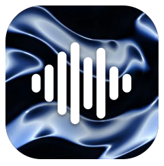
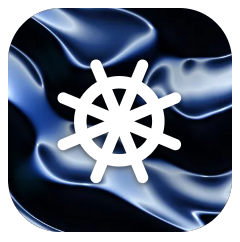
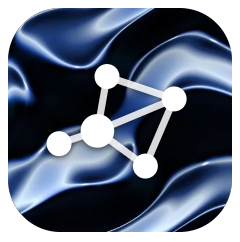
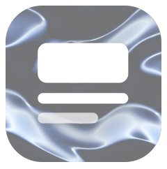

<picture>
  <source media="(prefers-color-scheme: dark)" srcset="assets/banner-dark.jpg">
  
</picture>

# ionian labs

**Build because you can.**

I make small tools for my own work. They are open source and free.

| | Tool | What it does | Status |
|---|---|---|---|
|  | **[Ionian Flow](https://github.com/ionianlabs/flow)** | Hold a key and speak. The words appear where you type. | LIVE |
|  | **Ionian Harness** | The setup I use to build with agents. | BUILDING |
|  | **Ionian Brain** | One memory for all my agents. Plain markdown. | BUILDING |
|  | **Ionian Stage** | Write once. Publish everywhere. | IDEA |

Speak with Flow. Build with Harness. Remember with Brain. Publish with Stage.

If it is useful to you, take it.

[ionian.dev](https://ionian.dev) · Made by one person · MIT
